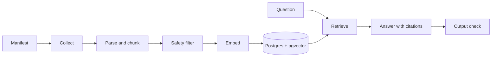

# branchiv-org

Silvia is a question-and-answer assistant about the public record of the lead azide
disposal at the Iowa Army Ammunition Plant (IAAAP) in Middletown, Iowa. That record
covers how the material came to be stored, who oversaw it, the permits and court
actions, public health notices, and the timeline of events. Every answer cites the
documents it relies on. It is planned to run at silvia.branchiv.org behind a login.
This repository holds the corpus, the ingest pipeline and, as it is built, the
retrieval and answering service.

## Status

Done:

- [x] Source manifest with trust tiers, caveat labels, safety flags and a validator
- [x] Polite collector with a provenance lock file, robots.txt support and manual import
- [x] Parsing (PDF and HTML) and overlapping chunking, with a per-document report
- [x] Database schema (Postgres + pgvector, Alembic), embedding client, Claude client
- [x] Refusal logging and session escalation rule

Next:

- [ ] Safety filter for flagged sources, with human spot checks
- [ ] OCR for the scanned PDFs that have no text layer
- [ ] Embed and load the corpus
- [ ] Retrieval
- [ ] Cited answers with an output check
- [ ] Eval set of questions with expected sources
- [ ] Web app and authentication
- [ ] Deployment

## Architecture



- **Manifest** (`data/manifest/sources.toml`): every source allowed into the corpus, with its tier, caveats and safety flag. Built.
- **Collect** (`ingest/collect.py`): downloads each manifest URL and records provenance in `collected.toml`. Built.
- **Parse and chunk** (`ingest/parse.py`, `ingest/chunk.py`): extracts PDF text per page (pypdf) and web-page main text (trafilatura), then splits it into about 400-word chunks with 15% overlap. Built.
- **Safety filter**: screens passages from flagged sources before indexing. Planned.
- **Embed** (`retrieval/embeddings.py`): Databricks-served GTE Large En v1.5, 1024 dimensions. Client built, not yet run on the corpus.
- **Postgres 18 + pgvector** (`corpus.py`, `migrations/`): `documents` and `chunks` tables with an HNSW vector index and full-text search. Schema built.
- **Retrieve**: hybrid vector and keyword search that prefers higher-tier sources. Planned.
- **Answer** (`llm/client.py`): Claude, through the Anthropic SDK. Client built, answering not yet wired.
- **Output check**: a second model pass that checks scope and citation support. Planned.

## Source corpus

The current manifest (snapshot `2026-11-23.3`) lists 119 sources:

| Tier | Meaning | Count |
|---|---|---:|
| 1 | Primary records: court filings, EPA permits and dockets, Army releases, congressional records, official statements | 47 |
| 2 | Official technical and historical: GAO, Inspector General, CRS, ATSDR, command histories | 22 |
| 3 | News, contract aggregators, advocacy groups, company claims | 49 |
| 4 | Own analysis, always labeled as analysis | 1 |

- **Caveats:** some sources carry caveat labels that answers must repeat when they cite them:
  - `unofficial_copy`
  - `archived_copy`
  - `advocacy_host`
  - `live_page`
  - `statement_claims_unverified`: a record that proves a statement was made, but not that its claims are true.
- **Snapshots:** each ingest is stamped with `snapshot_version`, so every chunk can be traced to the exact corpus it came from.
- **Lock file:** `data/manifest/collected.toml` records what was actually downloaded: URL, final URL, HTTP status, format, size, SHA-256, time, local path, and whether it was fetched or imported by hand. 96 sources are collected so far.
- **Raw files:** these live in `data/raw/`, which is git-ignored. Many are copyrighted articles and some are large. The lock file keeps the provenance in git.
- **Manual fetch:** `data/manifest/manual-fetch.md` lists the 23 sources the collector could not get. They include blocked sites, moved links, browser-only pages, records without a public link, and sites whose robots.txt disallows automated access. Each entry has the import command to use.
- **Politeness:** the collector honors robots.txt, uses a generic User-Agent and waits at least 2 seconds between requests to the same host. It retries only on 429 and 5xx responses, caps file size, and never follows links inside documents.

Field definitions and rules are in [data/manifest/README.md](data/manifest/README.md).
Per-document parse results are in [data/manifest/parse-report.md](data/manifest/parse-report.md).

## Safety and scope

Silvia covers the public record: what happened, when, who was responsible, and what
officials told the public. It does not provide technical detail about the material
itself. Scope is enforced in layers:

1. **Ingest filter.** Sources that may contain technical detail are flagged in the
   manifest. Their passages are screened, and a person spot-checks them, before they
   are indexed.
2. **Scope check.** Each question is classified before retrieval. Out-of-scope
   requests are declined.
3. **System instructions.** The answering model is instructed to stay within the
   public record and to cite its sources.
4. **Output check.** Answers are checked for scope and citation support before they
   are shown.

Official public-safety notices are returned verbatim, with a link to the issuing agency.

User input is retained only when a refusal happens. It goes to a separate
`refusal_events` table, kept for safety review. A single refusal never ends a session.
Repeated refusals in a short window can end the session and flag it for human review.
Nothing is reported to anyone automatically.

The flagging of sources and the refusal logging and escalation rule exist today. The
filter, the scope check and the output check are planned.

## Quickstart

Prerequisites: [uv](https://docs.astral.sh/uv/), Python 3.12 (uv can install it) and Docker.

```bash
uv sync
```

```bash
cp .env.example .env
```

`.env` needs these variables. Fill in the credentials; the rest have development defaults:

- **Model API:** `LLM_API_KEY`, `GENERATION_MODEL`, `CHECK_MODEL`, `JUDGE_MODEL`, `GENERATION_EFFORT`
- **Databricks embeddings:** `DATABRICKS_HOST`, `DATABRICKS_TOKEN`, `EMBEDDING_ENDPOINT`, `EMBEDDING_DIM`, `EMBEDDING_BATCH_SIZE`
- **Database:** `POSTGRES_USER`, `POSTGRES_PASSWORD`, `POSTGRES_DB`, `POSTGRES_PORT`, `DATABASE_URL`
- **Refusal escalation:** `REFUSAL_ESCALATION_THRESHOLD`, `REFUSAL_WINDOW_TURNS`

Start Postgres with pgvector, which listens on `127.0.0.1:5433`, then apply the migrations:

```bash
docker compose up -d
```

```bash
uv run alembic upgrade head
```

Validate the manifest:

```bash
uv run python -m branchiv_org.ingest.manifest
```

Preview what the collector would fetch, without any network calls:

```bash
uv run python -m branchiv_org.ingest.collect --dry-run
```

Fetch uncollected sources. `--doc-id`, `--limit` and `--refresh` narrow or repeat a run:

```bash
uv run python -m branchiv_org.ingest.collect
```

Import a file you downloaded by hand:

```bash
uv run python -m branchiv_org.ingest.collect import <doc_id> <path-to-file>
```

Parse and chunk everything collected:

```bash
uv run python -m branchiv_org.ingest.parse
```

Install the git hooks:

```bash
uv run pre-commit install
```

## Development

```bash
uv run ruff check .
```

```bash
uv run ruff format --check .
```

```bash
uv run mypy src tests
```

```bash
uv run pytest
```

- **Typing:** mypy runs in strict mode with the pydantic plugin.
- **Integration tests:** tests that need a real database are marked `integration` and are excluded by default. To run them, start Postgres and use `uv run pytest -m integration`.
- **No network:** all HTTP in tests goes through mocked transports.
- **CI:** `.github/workflows/ci.yml` runs lint, format check, mypy and pytest on every pull request and on pushes to main.
- **Pre-commit:** runs ruff and mypy on each commit.

## Repository layout

```
src/branchiv_org/
  config.py            settings loaded from .env
  db.py, corpus.py     SQLAlchemy session; documents and chunks tables
  ingest/              manifest, collector and lock file, parser, chunker
  llm/                 Claude client
  retrieval/           embedding clients (Databricks, plus a fake for tests)
  tracker/             refusal logging and escalation rule
  api/, eval/          placeholders
data/manifest/         sources.toml, collected.toml, manual-fetch.md, parse-report.md
migrations/            Alembic migrations
tests/
compose.yaml           local Postgres 18 + pgvector
```

## Roadmap

1. Safety filter and a human review queue for flagged sources, then OCR for the two scanned EPA PDFs.
2. Embed and load the corpus, then hybrid retrieval that prefers higher tiers.
3. Cited answers with scope and output checks. Caveat notes are shown with citations, and tier-4 analysis is labeled.
4. An eval set: questions paired with the sources a correct answer should cite.
5. A web app with login at silvia.branchiv.org, and deployment.

## License

License: TBD. The source documents belong to their publishers. They are referenced
by URL and checksum, and copies are not redistributed in this repository.
